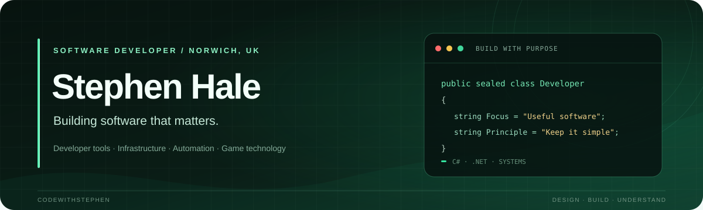

**Software Developer · Norwich, United Kingdom 🇬🇧**

*Building software, developer tools, and infrastructure with purpose.*

---

## About me

Hey, I’m **Stephen**, a software developer based in Norwich, UK. I enjoy building reliable, maintainable software and understanding how it works beneath the surface—from application architecture and developer tools to backend services, infrastructure, automation, and game technologies.

I aim for practical solutions with clean architecture, good performance, and room to maintain and grow.

## What I work on

- Applications with **C# and .NET**
- Server management and automation tools
- Developer utilities and tooling
- Networking, APIs, and infrastructure
- Clean, maintainable software architecture

## Technologies

**Languages**

**Frameworks & platforms**

.NET · ASP.NET · WinForms · Entity Framework

## Featured projects

| Project | What it does |
| --- | --- |
| **IW4MAdmin Discord Webhook Bot** | Connects IW4MAdmin to Discord with server status, player activity and stats, join/leave tracking, restart notifications, chat activity, and rule enforcement alerts. |
| **CWS Server Toolbox Menu** | An IW4x server administration menu with moderation, server controls, map voting, player management, and administration utilities. |

## How I think about software

> Build it well. Keep it simple. Make it maintainable.

## Find me online

- **Website:** [codewithstephen.com](https://codewithstephen.com)
- **GitHub:** [@CodeWithStephen](https://github.com/CodeWithStephen)

Feel free to explore my repositories, open an issue, or contribute to a project. I’m always happy to talk about software development, architecture, networking, and the tools that make building software better.
